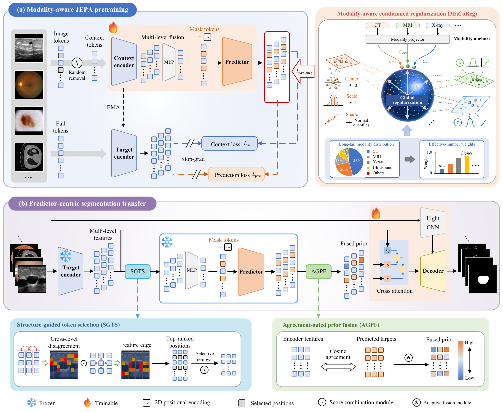

<h1 align="center">PredSeg</h1>

<p align="center"><strong>Latent Predictive Priors for Medical Image Segmentation</strong></p>

<p align="center">
  
  
  <a href="LICENSE"></a>
</p>

## 🧭 Overview

PredSeg reuses a pretrained JEPA predictor for medical image segmentation. During pretraining,
the predictor learns multi-level target representations from visible patch tokens. Modality-aware
Conditioned Regularization (MaCoReg) accounts for modality imbalance. During transfer,
Structure-Guided Token Selection (SGTS) selects query positions from frozen full-image encoder
features. Agreement-Gated Prior Fusion (AGPF) combines predictions at those positions with the
encoder features. The default decoder also uses a four-scale Light CNN detail pyramid.



## 📦 Pretrained Weights

Download `jepa-latest.pth.tar` from **Assets** and save it to
`outputs/pretraining/vit_small/jepa-latest.pth.tar`. [ViT-S/14 checkpoint (v0.1.0)](https://github.com/Rango-bit/PredSeg/releases/tag/v0.1.0)

The checkpoint initializes the frozen EMA target encoder and JEPA predictor for segmentation
transfer. If you store the file elsewhere, update `model.pretrained_path` in
`configs/segmentation/vit_small.yaml`. Set `meta.pred_depth` to match the checkpoint's predictor depth.

## 🛠️ Installation

Use Python 3.10 or later. Install a PyTorch and torchvision pair for your hardware, then install
PredSeg from the repository root. Run the commands below from that directory.

```bash
python -m pip install -e .
```

## 📂 Data preparation

Many of the medical imaging datasets used in PredSeg are listed in Microsoft's BiomedParseData
collection, which links to the original sources and hosts a subset of the datasets in processed form.
Sign in to Hugging Face and accept the access terms to download the hosted files.
[BiomedParseData on Hugging Face](https://huggingface.co/datasets/microsoft/BiomedParseData)

### Pretraining

Create `data/pretrain.csv` with image paths and modality IDs. Relative image paths are resolved
against `data.image_root` in the pretraining config.

```csv
img_path,modality_id
ct/scan_001.png,0
```

MaCoReg uses a cached modality feature tensor at `data/modality_features.pt` by default.
To create it, prepare `data/modalities.csv` with one description per modality. Assign contiguous
IDs starting at zero and use the same IDs in the image CSV.

```csv
modality_id,modality_text
0,A computed tomography image.
```

Generate the cache with local BiomedCLIP weights and a local PubMedBERT model and tokenizer.
The BiomedCLIP directory should contain `open_clip_config.json` and `open_clip_pytorch_model.bin`.

```bash
python -m pip install -e ".[text]"
python -m predseg.prepare_text --modalities data/modalities.csv --encoder biomedclip \
  --model-path /path/to/BiomedCLIP --tokenizer-path /path/to/PubMedBERT \
  --output data/modality_features.pt --device cuda:0
```

To pretrain using image features alone, set `train.use_conditional_regularization: false`.
The modality IDs and text cache are optional in that configuration.

### Segmentation

Create `data/train.csv` and `data/test.csv` with the same columns. Use `-` in `subfolder` for
files organized directly under the dataset directory. Save masks as single-channel binary images
with values 0 and 255.

```csv
dataset_name,subfolder,file_name,mask_file
GLaS,-,train_001.png,train_001_mask.png
```

```text
data/segmentation/GLaS/
├── train/
├── train_mask/
├── test/
└── test_mask/
```

For a named subset, place those four directories under `data/segmentation/<dataset>/<subfolder>/`.
For the `CXR` dataset, the loader selects bilateral lung masks named `<image_stem>_lung.<extension>`.

## 🚀 Training

Edit the data paths and per-device batch size in `configs/` before running the ViT-S/14 recipes.
Use `--devices cuda:0 cuda:1` for a local two-GPU run.

### Pretrain the encoder and predictor

```bash
predseg pretrain --config configs/pretraining/vit_small.yaml --devices cuda:0
```

The default checkpoint is `outputs/pretraining/vit_small/jepa-latest.pth.tar`.
The supplied ViT-S/14 recipes use 12 predictor blocks in both stages.

### Train a segmentation decoder

```bash
predseg segment --config configs/segmentation/vit_small.yaml --devices cuda:0 \
  --set data.dataset_name=GLaS
```

PredSeg loads the frozen EMA target encoder and predictor from `model.pretrained_path`.
Set this path to the matching pretraining checkpoint. The default `balanced` decoder combines
main-mask, auxiliary-mask, and boundary supervision. Each eligible dataset gets its own decoder.
Omit `--set data.dataset_name=GLaS` to train on all eligible datasets in the training CSV. Set
`meta.load_checkpoint: true` in the relevant config to resume a run from its latest checkpoint.

## 📊 Evaluation

```bash
predseg evaluate --config configs/segmentation/vit_small.yaml \
  --dataset-name GLaS --devices cuda:0 --save-predictions
```

Evaluation loads the decoder checkpoint with the lowest training loss and its pretrained backbone.
Results appear under `outputs/segmentation/vit_small/GLaS/test_results/`. Use `--checkpoint` to
select another decoder. All `predseg` commands are also available through `python -m predseg`.

## 🧪 Tests

```bash
python -m pip install -e ".[dev]"
python -m pytest -q
```

## 📄 License

PredSeg adapts Meta's I-JEPA and retains the CC BY-NC 4.0 license and attribution.
[I-JEPA](https://github.com/facebookresearch/ijepa) · [License](LICENSE) · [Notice](NOTICE)
